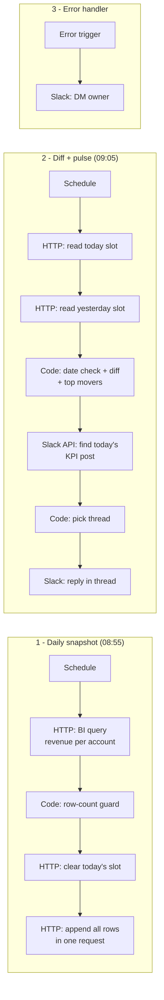

# revenue-change-tracker

Every morning a recurring-revenue number goes out to the team, and the first reply is
always *"it moved - because of whom?"*. This compares today's revenue per account with
a previous snapshot (yesterday or start of month), sorts every account into
**new / upgrade / downgrade / churn**, and posts the top movers as a Slack thread reply.
A small n8n setup takes the daily snapshot and runs the diff, with guards so the
"daily" comparison really is daily.

All data is synthetic (`company_001`, ...).
**Walkthrough page:** `docs/index.html` (GitHub Pages ready).

## What went wrong before (and what the guards are for)

The diff itself is easy. Keeping a trustworthy *previous* snapshot was the hard part:

- the scheduled job failed quietly one day, so the next "daily" diff actually covered
  two days and nobody noticed;
- snapshot slots were named by day of month (`day_18`), and a slot left over from last
  month looks exactly like yesterday's;
- a half-empty extract made dozens of healthy accounts look churned;
- accounts billed in a foreign currency moved with the exchange rate - which looked like
  a wave of downgrades even though nobody touched their plan.

So: every snapshot row carries its date, the job aborts below a minimum row count, the
diff refuses a stale slot (or falls back and says how many days it really covers), and
exchange-rate effects get their own `fx_only` bucket.

## The rules

Annual value = monthly revenue x 12.

| category | rule |
|---|---|
| new | nothing in the baseline, positive now |
| churn | positive in the baseline, nothing now |
| upgrade / downgrade | contract amount (in its own currency) went up / down |
| fx_only | same contract amount, value moved only because of the exchange rate |

For accounts in both snapshots the change is split into a **price effect** and an
**FX effect**. Bridge check: `baseline ARR + all changes = current ARR`, otherwise the
report says FAILED.

## n8n flow

Three workflows. Both scheduled ones point their *error workflow* setting at the third,
so any failure ends up as a DM instead of a missing message nobody notices.



Node by node:

1. **Daily snapshot**
   - *Schedule* 08:55, a few minutes before the KPI post goes out.
   - *HTTP Request* runs the saved BI query (header-auth credential).
   - *Code: row-count guard* throws if the extract has fewer rows than expected. The
     old slot stays as it was, and the error handler sends a DM.
   - *Clear* + *append* write the slot for today (`day_DD`). Every row starts with the
     snapshot date. The append is a single `values:append` call - one request per row
     hit the API rate limit at a few thousand rows.
2. **Diff + pulse**
   - *Read* today's and yesterday's slots.
   - *Code: date check + diff* first checks the dates inside both slots. If either is
     stale it throws, because no message is better than a wrong one. Then it classifies
     with the same rules as `src/diff.py`.
   - *Find today's KPI post* (`conversations.history`) + *pick thread*: the pulse goes
     in the thread of the morning revenue post, or in the channel if that post isn't
     there yet.
3. **Error handler** - *Error Trigger* -> Slack DM with the workflow name, error and a
   link to the execution.

Things that cost me time when setting it up:

- Header-auth credentials: the **Name** field is the header name (e.g. `x-api-key`),
  not a label for the credential.
- Turn on *Response -> Never error* on HTTP nodes while building; otherwise n8n
  swallows the API's real error message.
- If the rules live in Python **and** in a Code node, run both on the same snapshot and
  compare category totals before trusting either.

The JSON files in `automation/n8n/` are generated by `build_workflows.py` from the JS in
`automation/n8n/js/`. Import them, then pick your own credentials on the HTTP and Slack
nodes. Env vars used: `BI_BASE_URL`, `REVENUE_QUESTION_ID`, `SNAPSHOT_SHEET_ID`,
`PULSE_CHANNEL_ID`, `ALERT_USER_ID`.

## The Slack pulse

```
Revenue movers - 2026-03-18 vs 2026-03-17 (yesterday)
ARR 2,331,546 (net +39,866)
🟢 new - 3 accounts, +76,997
      company_132 +75,288, company_133 +900, company_134 +809
⬆️ upgrade - 1 accounts, +1,488
⬇️ downgrade - 2 accounts, -22,045
🔴 churn - 2 accounts, -5,763
💱 fx only - 24 accounts, -10,812 (exchange rate, no plan change)
Bridge check: OK | annual value = monthly x 12 | top 5 per category
```

The Python version (`python src/main.py pulse ...`) does the same as the n8n flow and is
handy for testing. It's dry-run by default and writes `pulse_preview.json`.

## Run it

```bash
pip install -r requirements.txt
python data/generate_dummy_data.py
python src/main.py diff  --baseline month-start --today 2026-03-18
python src/main.py diff  --baseline yesterday   --today 2026-03-18
python src/main.py pulse --baseline yesterday   --today 2026-03-18     # dry-run
python src/simulate_days.py                    # replays 5 days so every guard fires
python docs/build_site.py                      # rebuild the walkthrough page
```

`--baseline` is required on purpose - "compared to what?" changes the answer completely.
To really post, fill `.env.example` and add `--send`.

## Files

```
data/                      generator, live extract, daily snapshot slots
src/diff.py                compare, classify, FX split, top 15, summary
src/snapshot.py            snapshot job + guards + baseline lookup
src/pulse.py               Slack message; slack_client.py sends it
src/main.py                CLI: snapshot | diff | pulse
src/simulate_days.py       guard demo on a copy of the snapshot store
automation/n8n/            workflow JSON, the JS used in Code nodes, generator
automation/crontab.example the same schedule without n8n
docs/                      walkthrough page
```

Python, pandas, openpyxl, n8n, Slack API, Chart.js (walkthrough page).
