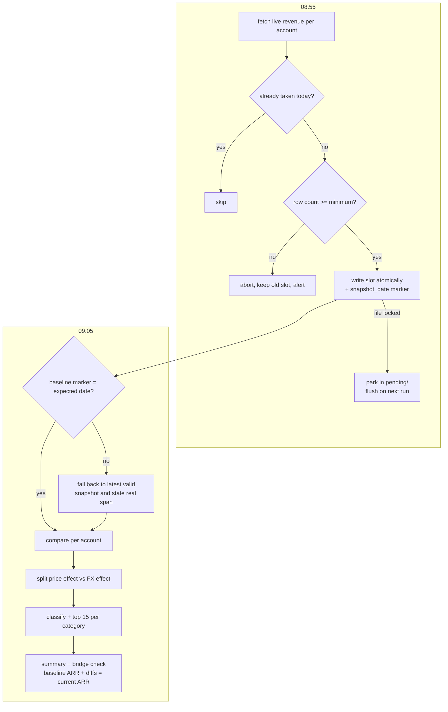

# Recurring Revenue Change Tracker

## Overview
Compares the current recurring revenue of every account with a previous snapshot
(start of month or yesterday), classifies each account as **new / upgrade / downgrade /
churn**, lists the top 15 accounts per category by annualized difference and writes a
summary workbook. A small snapshot job with guards keeps one reliable snapshot per day
so the "vs yesterday" comparison is always what it claims to be.

All data is synthetic (fictional accounts `company_001` ...).

## Problem
A daily revenue number posted to a team channel always triggers the same question:
*"it moved - because of whom?"* Answering it needs a trustworthy previous snapshot, but
in practice:

- a scheduled job silently fails one day, and the next "daily" diff actually spans two days;
- snapshot slots named by day-of-month get re-used each month, so a stale slot from last
  month looks like yesterday;
- a partial extract makes dozens of healthy accounts look churned;
- accounts billed in a foreign currency move with the exchange rate, which looks like a
  wave of downgrades although nobody changed plan.

## Approach


**Classification** (annualized value = monthly revenue x 12):

| category | rule |
|---|---|
| new | absent or zero in the baseline, positive now |
| churn | positive in the baseline, absent or zero now |
| upgrade / downgrade | positive in both, contract amount (local currency) went up / down |
| fx_only | contract amount unchanged, value moved only because of the exchange rate |

For accounts present in both snapshots the diff is split into a **price effect** and an
**FX effect** (`local amount x (rate now - rate before) x 12`), so the report separates
real business movement from currency revaluation.

**Automation design.** Two scheduled jobs (cron, or an n8n-style workflow with a schedule
trigger) plus an error handler:

1. *Snapshot* - fetch, guard on row count, write the day's slot, then write the date
   marker. The marker step is not optional: if the write step only touches data rows,
   the slot keeps last month's date and the diff job will (correctly) refuse it.
2. *Diff* - runs a few minutes later, validates the baseline marker, computes the diff
   and posts the top movers to a chat thread.
3. *Error handler* - any non-zero exit sends an alert, so failures are never silent.

`automation/crontab.example` shows the schedule; `src/snapshot.py` implements the guards.

## Project structure
```
data/generate_dummy_data.py    seeded synthetic snapshots + live extract
data/source_current.csv        "live" revenue per account (today = 2026-03-18)
data/snapshots/day_XX.csv      daily slots; day_18 is a stale slot from last month
src/diff.py                    compare, classify, FX split, top 15, summary
src/snapshot.py                snapshot job + guards + baseline lookup
src/main.py                    CLI: snapshot | diff --baseline month-start|yesterday
src/simulate_days.py           replays several days to show every guard firing
automation/                    cron example + alert hook placeholder
output/                        example results from the dummy data
```

## How to run
```bash
pip install -r requirements.txt
python data/generate_dummy_data.py
python src/main.py diff --baseline month-start --today 2026-03-18
python src/main.py diff --baseline yesterday   --today 2026-03-18
python src/simulate_days.py                        # guard demo on a copy of the store
python src/main.py snapshot --today 2026-03-18     # real job: overwrites the stale day_18 slot
```
`--baseline` is mandatory: the tool refuses to guess which comparison you meant.
The `snapshot` command writes into `data/snapshots` (re-run the generator to reset it);
use `simulate_days.py` if you only want to watch the guards.

## Example output (dummy data)
Month-start vs 2026-03-18 summary:

| category | accounts | annual diff | price effect | FX effect |
|---|---:|---:|---:|---:|
| new | 10 | 216,196 | 216,196 | 0 |
| upgrade | 13 | 130,862 | 131,868 | -1,006 |
| downgrade | 3 | -12,613 | -12,443 | -170 |
| churn | 10 | -43,056 | -43,056 | 0 |
| fx_only | 20 | -12,479 | 0 | -12,479 |
| unchanged | 73 | 0 | 0 | 0 |
| **total** | 129 | 278,910 | 292,565 | -13,655 |

Bridge check: baseline ARR + total diff = current ARR -> OK.
Without the FX split, the 20 `fx_only` accounts would have been reported as downgrades.

Guard simulation (`python src/simulate_days.py`):
```
03-18 08:55 scheduled run        OK: 119 rows -> day_18.csv
03-18 09:30 manual re-run        SKIP: snapshot for today already taken
03-19 08:55 partial extract      ABORT: only 50 rows (< 100), slot left untouched
03-19 09:10 retry, file locked   PENDING: ... parked in pending/ for the next run
03-20 08:55 scheduled run        flushed pending ['2026-03-19']; OK: 119 rows -> day_20.csv
diff on 2026-03-15 vs yesterday  -> WARNING: slot for 2026-03-14 is missing or stale;
                                    using 2026-03-01 instead - this diff covers 14 days
```

## Validation / lessons learned
- **Trust the marker, not the file name.** Re-used day-of-month slots are convenient but
  ambiguous; a date stored inside the snapshot is the only reliable label.
- **A missing snapshot must be loud.** Silent scheduler failures were the main source of
  wrong "daily" numbers; a non-zero exit + alert, and a diff that states its real span,
  fixed that.
- **An empty or partial extract is not churn.** Abort below a row-count floor instead of
  publishing a list of fake churned accounts.
- **Separate FX from price.** Classify on the contract amount; report currency effects on
  their own line.
- **Batch writes.** When the destination is a spreadsheet or API, append all rows in one
  request; one request per row hits rate limits with a few thousand rows.
- Keep the diff rules in one place; if they are re-implemented inside a workflow tool,
  test both against the same input and compare the totals.

## Tech stack
Python, pandas, openpyxl (optional), cron / n8n-style scheduler. Data generation uses only
the standard library.
